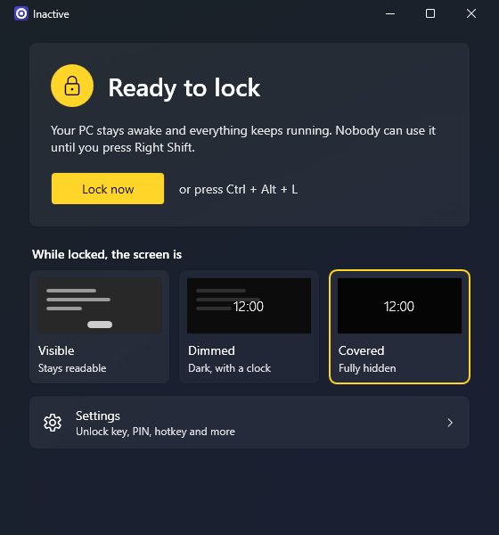

<p align="center">
  
</p>

<h1 align="center">Inactive</h1>

<p align="center">
  <strong>Lock your mouse and keyboard when you walk away. Everything else keeps running.</strong>
</p>

<p align="center">
  <a href="https://github.com/28Y8/Inactive/releases/latest/download/Inactive-win-Setup.exe"><strong>Download for Windows 11</strong></a>
  &nbsp;·&nbsp;
  <a href="#honest-limits">Honest limits</a>
  &nbsp;·&nbsp;
  <a href="CHANGELOG.md">What's new</a>
</p>

<p align="center">
  
</p>

Inactive is a small tray app for the moments you step away from your PC but want it to keep working.
Press **Lock now** or **Ctrl + Alt + L**. Your PC stays awake and your downloads, renders, video and
games carry on, but your apps stop responding to the mouse, keyboard and touch screen, with a few
[exceptions](#honest-limits) such as games that read the mouse directly. Press **Right Shift** and you
are back, with nothing to sign in to and nothing to reopen.

It is good for keeping a cat, a child or a stray elbow away from whatever is on your screen. It is
not a replacement for locking Windows: see [Honest limits](#honest-limits).

## Install

1. [Download Inactive-win-Setup.exe](https://github.com/28Y8/Inactive/releases/latest/download/Inactive-win-Setup.exe).
2. Run it. Inactive installs for your Windows user only and does not ask for administrator rights.
3. Find it in the Start menu.

You need Windows 11 on a 64-bit (x64) PC. There is nothing else to install. Updates arrive on their
own and never interrupt a lock.

### "Windows protected your PC"

The installer is not code signed yet, so SmartScreen will probably show this warning. Select
**More info**, then **Run anyway**. Code signing certificates cost money, so the project plans to
apply to the [SignPath Foundation](https://signpath.org/), which signs open source projects for free.

Inactive blocks input with keyboard and mouse hooks, which is also a thing that malware does, so
some antivirus tools may flag it. You can read every line of the source here and
[build it yourself](#build-from-source) if you prefer.

## Use

Inactive lives in the notification area, next to the clock. Closing its window hides it there. To
quit, right click the tray icon and choose **Exit**.

**To lock**, do any one of these:

- Select **Lock now** in the main window.
- Press **Ctrl + Alt + L**.
- Right click the tray icon and choose **Lock now**.

The first time you lock, Inactive shows you the unlock key and asks you to confirm, so that nobody
gets locked out by surprise.

**While locked**, the PC stays awake, the cursor sits still in the centre of the main screen and the
tray icon changes. If someone touches the keyboard or mouse, a short "This PC is locked" message
appears.

**To unlock**, press **Right Shift** or the key you picked instead. If you set a PIN, type it next.
Inactive checks it as soon as all the digits are in. Escape cancels. The unlock key may not work while
an administrator window has focus. If that happens, the lock screen tells you to use the route below.

### If you cannot get back in

You can always get out, even if you forget the unlock key or your PIN:

1. Press **Ctrl + Alt + Del**. Windows handles this before any app sees it.
2. Choose **Lock**.
3. Sign back in to Windows as usual. Inactive sees that you signed in and lets go by itself.

Unlocking needs a physical keyboard, because touch does nothing while locked. Before you lock a tablet,
make sure that one is attached. If you lock one in tablet mode, Inactive asks you first.

If Inactive itself has hung and signing back in does not help, use **Sign out** from the
Ctrl + Alt + Del menu. Task Manager may open behind the lock screen and ignore input, so do not rely
on it.

**Forgot your PIN?** After signing back in, right click the tray icon and choose **Exit**, then delete
`%APPDATA%\Inactive\settings.json`. This resets all of your Inactive settings, including the PIN.

## Settings

| Setting | Default | What it does |
| --- | --- | --- |
| Unlock key | Right Shift | The key that ends a lock. Most keys work. Enter, Escape, Tab, Space, Backspace, digits and the Windows keys are refused. Letters work, but Inactive warns you because they are easy to press by accident. |
| PIN | Off | Asks for 4 to 8 digits after the unlock key. After 5 wrong tries, the unlock key stops working for 30 seconds. That wait doubles each further time, up to 5 minutes. Changing or removing a PIN requires the current one. |
| Lock hotkey | Ctrl + Alt + L | The shortcut that locks from anywhere. If another app already uses it, Settings tells you. Shift alone cannot be paired with a key that types a character. Windows treats AltGr as Ctrl + Alt, so on a keyboard where AltGr + L types a character, choose another hotkey. |
| While locked, the screen is | Dimmed | On the main page. **Visible** leaves the screen fully readable. **Dimmed** darkens it. **Covered** hides it behind near-black, which suits privacy and OLED screens. |
| Show the clock | On | Shows the time and date on the main screen while locked, in Dimmed and Covered. |
| Message | Empty | A short note to show while locked, such as "Back in 5 minutes". |
| Show the unlock key | Off | Shows the unlock key on the lock screen. It is off because anyone could read it. |
| Let the display turn off | Off | Keeps the PC awake but allows the screen to sleep as usual. For long locks on an OLED screen, turn this on or use Covered. |
| Start with Windows | Off | Starts Inactive quietly in the tray when you sign in. The window opens only if your settings could not be read. |
| Automatic updates | On | Checks GitHub for new versions and downloads them in the background. A downloaded update installs when you exit Inactive or the next time it starts. |

Settings are stored in `%APPDATA%\Inactive\settings.json` and survive updates.

## Honest limits

**Inactive is a privacy deterrent, not a security boundary.** It stops casual use of your PC. It does
not stop someone who knows what they are doing and has your PC in front of them. When it really
matters, press **Win + L** to lock Windows instead.

Some things cannot be blocked, and Inactive does not try:

- **Ctrl + Alt + Del.** Windows reserves it, and it is the guaranteed way out. It also means that a
  person at the keyboard can sign you out and, in some setups, such as when Task Manager runs as
  administrator, may be able to close Inactive there.
- **Win + L, the power button and the sleep button.** These still work.
- **Administrator prompts.** A User Account Control prompt appears on a protected screen that
  Inactive cannot touch.
- **Closing a laptop lid.** Windows follows your lid setting. Inactive cannot keep a laptop awake with
  the lid shut if Windows is set to sleep. A low battery can also put it to sleep.
- **Windows restarts.** If Windows signs out or restarts, for example to finish an update, Inactive
  lets go straight away and does not delay it. Inactive closes at that point too. If another app then
  stops the restart, your PC stays unlocked until you start Inactive again.

There are some gaps to know about as well:

- **Anyone who can sign in to Windows as you.** Signing back in ends the lock, even with a PIN set. On
  an account with no password, Win + L and then Sign in is enough.
- **Apps running as administrator.** Windows hides input from normal apps while an administrator
  window has focus, so Inactive cannot block it and the unlock key may not work. Inactive tries to
  move focus away from that window, but this can fail. Input can reach that window until it does. If
  focus stays there, the lock screen asks you to press Ctrl + Alt + Del, choose Lock and sign in.
- **Touch screens.** Touch is blocked by a window that covers the screen, not by the hooks. System
  gestures such as swiping in from the edge may still work.
- **Precision touchpads.** Windows may handle touchpad gestures itself, so they may show window
  thumbnails or switch desktops, even in Covered.
- **Games and other apps that read raw input.** The hooks may not stop this, so moving the mouse can
  still turn the camera in some games, and some may see key presses too.
- **Keys handled by the hardware.** Keys that your keyboard deals with itself, such as screen
  brightness on many laptops, never reach Windows.
- **Remote control tools.** Input from these is treated like a physical keyboard and mouse. It is
  blocked, but the unlock key still works.
- **What others can see.** Visible and Dimmed do not hide your screen. Use Covered if you do not want
  it read. Sound and notifications carry on as normal.

The PIN only guards the lock. It is not your Windows password, so do not reuse one. See
[SECURITY.md](SECURITY.md) for the full threat model.

## Privacy

Inactive has no telemetry, no accounts and no analytics.

- It never logs or stores a keystroke. The keyboard and mouse hooks exist only while the PC is locked.
- A PIN is stored only as a salted PBKDF2-SHA256 hash, never as the digits themselves.
- A small log in `%APPDATA%\Inactive\logs` records when locks start and end, plus any errors. It never
  contains keys or PINs. Nothing sends it anywhere.
- The updater keeps its own log at `%LOCALAPPDATA%\velopack\velopack_Inactive.log`, with launch, update
  and install activity and paths that include your Windows user name. It never contains keys or PINs.
- The only network traffic is the update check to GitHub. Turn off automatic updates and Inactive
  connects only when you ask it to check.

## Uninstall

Remove Inactive from **Settings > Apps > Installed apps**. This also removes it from startup. Your
settings stay in `%APPDATA%\Inactive`, so delete that folder too if you want them gone. The updater's
log stays as well: delete `%LOCALAPPDATA%\velopack\velopack_Inactive.log` by hand, but keep the
`velopack` folder, because other apps built with Velopack share it.

## Build from source

You need Windows and the [.NET 10 SDK](https://dotnet.microsoft.com/download/dotnet/10.0).

```powershell
git clone https://github.com/28Y8/Inactive.git
cd Inactive
dotnet build Inactive.slnx
dotnet test --solution Inactive.slnx
```

The app ends up at `src\Inactive\bin\Debug\net10.0-windows\Inactive.exe`. To build an installer, run
`build\pack.ps1 -Version 1.0.0`. It writes `artifacts\Releases\Inactive-win-Setup.exe`. A build from
source logs updater activity to `%LOCALAPPDATA%\velopack\velopack.log`.

Want to help? Start with [CONTRIBUTING.md](CONTRIBUTING.md). For how the lock works inside, read
[docs/ARCHITECTURE.md](docs/ARCHITECTURE.md).

## License

[MIT](LICENSE). Copyright (c) 2026 28Y8.
