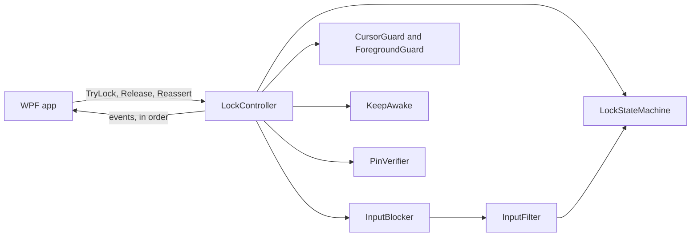
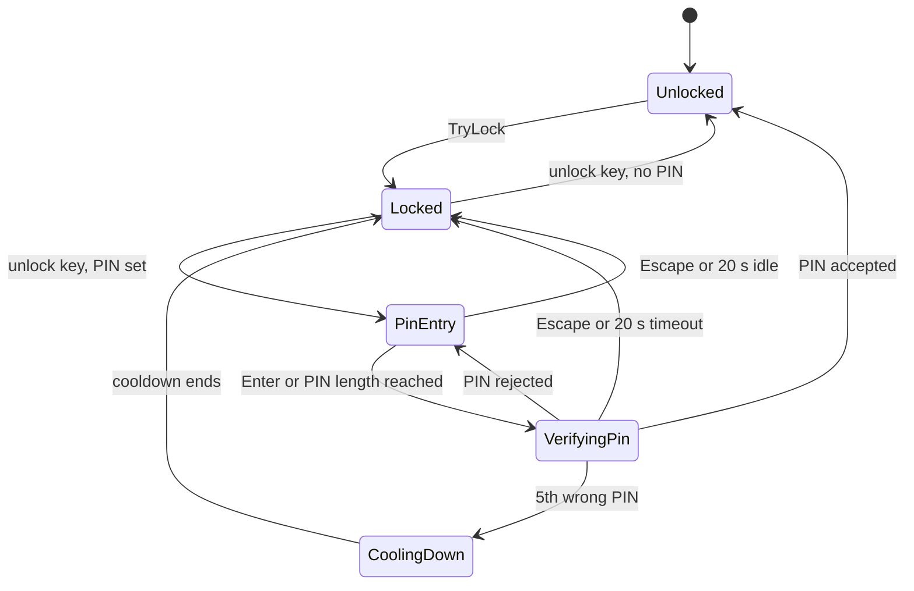

# Architecture

Inactive blocks a person's mouse and keyboard, so its design starts from one question: what happens
when something goes wrong? This document covers the threads, the failure modes and the reason each
guard exists.

## Principles

1. **Fail open.** If the process dies, Windows removes the hooks and the PC is free. Nobody can be
   trapped for good.
2. **The hook thread decides alone.** The unlock key works even if the UI thread is hung. Unlocking
   never depends on the dispatcher.
3. **The hook path is fast and allocation free.** Windows silently removes a hook that takes too long,
   and a garbage collection pause inside a callback could cause exactly that.
4. **Work with Windows, not against it.** What Windows reserves, such as Ctrl+Alt+Del and the secure
   desktop, stays reserved. It is documented as a limit and also serves as the escape hatch.

## Layout

| Project | Role |
| --- | --- |
| `Inactive.Core` | The lock engine, settings, PIN hashing and logging. No WPF. |
| `Inactive` | The WPF app: main window, settings, overlay, tray, updates and startup registration. |
| `Inactive.Tests` | Unit tests. They run the engine against fakes and never install a real hook. |

The UI talks to `LockController` and nothing else in the engine, apart from `ElevatedFocusWatch`, a
small piece of pure timing logic that lives in the core so that it can be tested.

## Threads

| Thread | Kept alive by | What it does | If it stalls |
| --- | --- | --- | --- |
| WPF UI | App lifetime | Windows, overlay, tray | The lock is unaffected. The unlock key still works, and if the UI cannot then remove the overlays the process ends (see failure modes). |
| `Inactive input hooks` | Lock session. Foreground thread, highest priority | Owns both low level hooks and their message loop. Decides and tears down. | Windows drops the hooks and input flows again (fail open). |
| `Inactive lock events` | App lifetime, once started | Delivers controller events in order | Later events wait. Input handling is unaffected. |
| `Inactive cursor guard` | Lock session | Pins the cursor every 50 ms | The mouse hook still blocks movement. |
| `Inactive foreground guard` | Lock session | Checks for an elevated foreground window every 500 ms | Input to elevated windows may go unnoticed. |
| `Inactive PIN verifier` | Lock session with a PIN | Runs PBKDF2 away from the hook thread | `VerifyingPin` times out after 20 s. |
| `.NET System Events` | App lifetime | Started by `Microsoft.Win32.SystemEvents`. Runs the session, power and display handlers | A release through sign-in waits. It runs handlers one at a time, so another subscriber on the UI context, such as WinForms `Screen`, can hold it up during a UI hang. |
| `Inactive keep awake` | App lifetime, once started | Holds the execution state and reapplies it every 30 s | The PC may sleep on its normal timer. |

The hook thread is a foreground thread on purpose. If the UI thread ends without releasing, the
process stays alive and the unlock key keeps working until someone presses it.

## Life of a lock

**Locking.** `TryLock` runs these steps in order:

1. Refuses a bad request: already locked, an unlock key that could never work or a damaged PIN
   credential. A lock that cannot be unlocked must not start.
2. Acquires keep awake. A failure here is logged, but the lock goes ahead.
3. Creates the session and starts the guards. All of this comes before the hooks, so that the hook
   thread alone owns the teardown from the moment they are on.
4. Starts the hook thread and waits. If either hook fails, the guards stop, keep awake is released and
   `TryLock` returns `HookInstallFailed`. The UI creates its overlays before calling `TryLock`, so a
   failure there never leaves hooks on.

**Unlocking.** After the unlock key or a PIN, the machine first drains: the hooks stay on until every
key it saw go down has come up, for 500 ms at most. On the 250 ms tick of the hook thread, that can
reach 750 ms. During the drain, repeats of a held key and Enter are swallowed, so a held last digit or
a trailing Enter does not land in the foreground app. Other keys and the mouse already pass. Other
reasons skip the drain, and `Release` cuts it short. An Enter pressed after every key is up and the
hooks are off cannot be caught.

The state machine then asks the blocker to stop. On the hook thread, the teardown runs in a fixed
order: hooks off, guards stopped, keep awake released, `Unlocked` queued. `Release` from another thread
follows the same path and waits for it, for at most 2 seconds.

`IsLocked` turns false before the teardown ends, by up to the length of the drain, and `TryLock`
returns `AlreadyLocked` in that gap. The UI re-locks only after the `Unlocked` event.

## The state machine

`LockStateMachine` holds all lock logic and makes no Win32 calls. Time comes from an injected clock,
so tests are deterministic. Each member takes a short internal lock, because the hook thread, the PIN
verifier and any releasing thread all call in.

`Release` can move any phase straight to `Unlocked`.

Details worth knowing:

- **Arming.** If the unlock key is already down when the lock starts, it counts only after it has been
  released.
- **Repeats.** A low level hook reports auto repeat as plain key downs, so the machine tracks held
  keys. That tracking expires after 1.5 s, because a key up lost during a secure desktop visit would
  otherwise disable the unlock key for good.
- **PIN digits.** They live in a fixed buffer that is wiped after use. The verifier copies them, runs
  PBKDF2 on its own thread and returns a result with a token. A result whose token is out of date, for
  example after Escape, is ignored.
- **Cooldown.** The fifth wrong PIN starts a cooldown of 30 s. Each further cooldown doubles, up to
  5 minutes. The unlock key is ignored in the meantime.

## Input decisions

`InputFilter` runs inside the hook callbacks and turns each event into pass or swallow.

| Event | Decision | Reason |
| --- | --- | --- |
| Key down | Swallowed, including the unlock key and PIN digits | Nothing typed may reach the foreground app. |
| Key up of a key pressed during the lock | Swallowed | Windows never saw the press, so nothing is left stuck, and passing the release would show PIN digits to the foreground app in typing order. |
| Key up of any other key | Passes | A key held while locking, such as the hotkey's Ctrl and Alt, would otherwise stay stuck. A key up with no key down is harmless. |
| Mouse move, wheel, button down | Swallowed | This is the core of the lock. |
| Mouse button up | Always passes | Same reason as key up: the click on the Lock button is still in progress. |
| Injected key | Same as physical | Remote control tools can still press the unlock key. |
| Key down after the machine unlocked, outside the drain | Passes, and so does its key up | Windows sees this press, so swallowing the release would leave the key stuck. |
| Injected mouse move onto the pinned point | Passes silently | This is `CursorGuard`'s own `SetCursorPos`. Counting it would look like someone using the mouse. |

To tell the two kinds of key up apart, the filter asks `GetAsyncKeyState` at each swallowed press. A low
level hook runs before Windows updates that state, so it reads false for a fresh press and true for a
key that Windows already holds down, such as a hotkey key repeating after the lock started. The call
is fast and allocation free. If it ever errs towards "down", the release passes, which is harmless.

`InputAttempted` is throttled to once every 2 s, and the first signal waits 750 ms, because the keys of
the lock hotkey often repeat for a moment after locking.

## Events

Engine threads post plain value structs into a ring of 128 slots. Posting never blocks and never
allocates, which makes it safe inside a hook callback. A test measures 0 bytes allocated across the
callback paths.

When the ring is full, the oldest event is dropped, because the newest is the one that describes the
current state. Subscribers marshal to the dispatcher with `BeginInvoke`, since the UI thread may be
blocked in `Release`. `LockCoordinator` then waits for the UI to take the overlays down, which blocks
only this thread, and only after the lock is over.

## Why each guard exists

| Guard | Problem it solves |
| --- | --- |
| Keyboard and mouse hooks | The primary block. They swallow input before any app sees it. |
| Hook reinstall every 10 s | Windows silently removes a hook that once timed out, with no notification. New hooks go on before the old ones come off, so there is no gap. A failed reinstall leaves the old hooks in place and is logged, because they may still work. Nothing can tell whether they do, so after 30 s of unbroken failure the hook thread gives up and the lock ends with `EngineFault`. A lock that neither blocks nor ends is the worst outcome. |
| Overlay windows | Touch input does not pass through the mouse hook, so a hit-testable window has to absorb it, even in Visible style. They use `WS_EX_NOACTIVATE` so that the foreground app keeps focus and fullscreen video and games keep running. |
| `CursorGuard` | Defence in depth for movement the hooks miss, for example during a hook gap. It reasserts `SetCursorPos` every 50 ms. The centre is worked out on every pass, so display changes are picked up automatically. It avoids `ClipCursor` on purpose: a clip has no owner, so it outlives a killed process, and a test on real hardware left the mouse stuck after the process was gone. |
| `ForegroundGuard` | Low level hooks do not see input while an elevated window has focus. Access denied from `OpenProcess` also counts as elevated. It raises `ElevatedForeground` and the UI tries to activate the overlay. This is best effort, so the event repeats for as long as the condition holds. The unlock key may not work in the meantime, so after 2 s the primary overlay shows the Ctrl+Alt+Del route. That reveals nothing about the unlock key, so `ShowUnlockHint` does not apply. |
| `KeepAwake` | `SetThreadExecutionState` is per thread, so a dedicated thread owns it and reapplies it every 30 s. The display flag is left out when the user allows the display to turn off. |
| `PinVerifier` | PBKDF2 takes far longer than a hook may run. |
| Session events in the UI | `SessionSwitch` unlock means the person just proved who they are to Windows, so the lock releases. Session ending releases at once, so that a shutdown is never held up. Resume and display changes call `Reassert`. These handlers run on the system events thread, because `SystemEventBridge` subscribes with the UI context out of the way, so a hung UI does not block them. If the restart or sign out is then cancelled, Inactive has already exited, because WPF shuts down on any query it does not cancel, so the PC stays unlocked until someone starts it and locks again. |

## Failure modes

| What happens | Result |
| --- | --- |
| Process crashes | Windows removes the hooks. Input returns at once. The execution state goes with the thread. |
| Process is killed | As above. Nothing runs first and nothing needs to. |
| UI thread hangs | The unlock key still works. The hooks come off and the cursor is freed. If the UI has not removed the overlays 5 s after the lock ends, for any reason but exit or shutdown, Inactive logs an error and ends its own process, because only the UI thread can close them. Windows then removes them. |
| A hook fails to install | The lock is aborted, nothing stays engaged and the user sees the error. |
| Windows drops a hook | Input flows until the next reinstall, at most 10 s later. The other hook, `CursorGuard` and the overlay keep working. |
| Reinstalls keep failing | The old hooks stay on for 30 s. If reinstalling still fails, the lock ends with `UnlockReason.EngineFault`, which also lets go of hooks that may have been working. |
| An elevated window keeps focus | The unlock key may not reach the hooks. After 2 s the overlay shows the Ctrl+Alt+Del route, and the first refusal to take focus is logged. |
| Hook thread throws or `GetMessage` fails | The `finally` block removes the hooks and the lock ends with `UnlockReason.EngineFault`. The UI restores itself whatever the reason. |
| Hook thread does not stop in time | `Release` gives up after 2 s and logs an error, so a shutdown is not held up. Windows removes the hooks when the process ends. |
| Ring of events overflows | The oldest events are dropped. The lock is unaffected. |
| Key up lost on the secure desktop | Held key tracking expires after 1.5 s, so the unlock key recovers. |
| PIN check never returns | `VerifyingPin` times out after 20 s and returns to `Locked`. |
| Unlock key or PIN credential in settings is invalid | `TryLock` refuses it up front with a clear error. |
| Settings file is corrupt | Inactive starts on defaults, keeps the file as `settings.json.bak` and says so on the home page. The window opens even with `--background`, because the next start finds no file and no problem. |
| Settings file stays unreadable | Reading retries for a moment. If that fails, Inactive runs on defaults, says so on the home page, opens the window even with `--background` and saves nothing for that run, because saving would replace a file that may be fine. |
| Log cannot be written | Ignored. A log never takes the app down with it. |
| Person is stuck | Ctrl+Alt+Del, Lock, then sign back in. `SessionSwitch` releases the lock on the system events thread, without the UI. Another subscriber on the UI context could still stall that thread during a UI hang, so the fallback is Sign out from the same menu. |

## Things that cannot be blocked

Ctrl+Alt+Del, Win+L, the power button and the UAC secure desktop are handled by Windows before any
hook runs. Laptop lid close is a power policy that `SetThreadExecutionState` does not override. These
are limits by design. Inactive does not try to work around them, and the README states them for users.

## Settings and logs

Settings live in `%APPDATA%\Inactive\settings.json`, outside the install folder, so they survive
updates. Saving writes a temporary file and then replaces the original. Unknown fields are ignored and
an unreadable `ScreenStyle` or `LockHotkey` falls back to its default, so that a file from a newer
version does not lose everything. A null `CustomMessage` reads as empty, because the deserializer does
not enforce nullable annotations. `RespectNullableAnnotations` must stay off: it would make that one
value corrupt the whole file and reset the PIN.

`AppSettings` properties have setters instead of `init`, because the JSON source generator zeroes absent
`init` properties, which would turn a partial file into `UnlockKey = 0`. Treat instances as immutable
and change them with `with`.

`AppLog` writes to `%APPDATA%\Inactive\logs` and rolls over at 1 MB. It must never be called from a hook
callback and must never receive a key value or PIN digit. Velopack keeps its own log at
`%LOCALAPPDATA%\velopack\velopack_Inactive.log`. It cannot be turned off, has no size cap and outlives
an uninstall, and an uninstall hook could not delete it, because the updater writes to it afterwards.

## Updates

`UpdateService` uses Velopack with GitHub Releases as the source. It does nothing in development
builds, where `IsInstalled` is false. An update is never applied during a lock. A download that is
ready waits for a restart that the user chooses, for the next normal exit or for the next first
launch.

Velopack checks a package's size and SHA256 against the feed of the same release, which catches
corruption but not tampering, and it checks no signature. So a release is trusted because of who can
publish it. A package that is already waiting stays waiting if its release is deleted, so only a higher
version can replace a bad release.

That last one needs care. By default, every launch of a Velopack app applies a waiting update, and
applying ends every copy running from the install folder, which would drop a lock with no key or PIN.
So `Program.Main` turns auto apply off when the single instance mutex already exists, before Velopack
runs. A second launch then only signals the first.

Startup registration writes the stable Velopack stub path to the HKCU `Run` key, not the versioned
`current` path, so updates do not break it. At startup only an installed copy rewrites the entry, so
that an uninstalled build cannot take it over. The Settings toggle shows what the key really says. The
uninstall hook removes the key.

## Debug only code

Under `#if DEBUG`, `--demo-lock <seconds>` locks at startup and releases by itself with
`UnlockReason.DemoTimer`, while `--demo-log <path>` records the outcome and the swallowed event counts.
The `INACTIVE_UPDATE_FEED` environment variable swaps the update source for a local folder, for testing
an install and update by hand. None of this exists in a Release build.

## Testing

Everything that touches Win32 sits behind a seam (`ILockPlatform`, `IHookApi`, `IInputBlocker`), so the
tests drive the whole engine with fakes and a manual clock. The real hook callbacks and the `Win32*`
adapters are the one part that unit tests cannot reach. They are checked by hand with `--demo-lock`.
